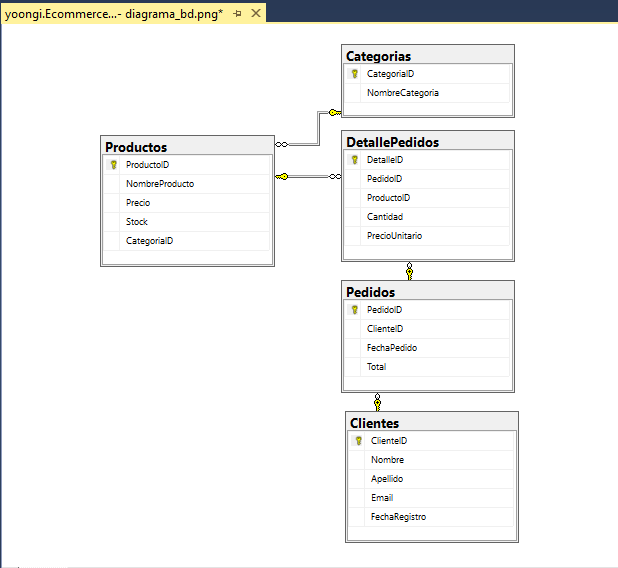

# sql-server-BankDataDB

Este proyecto simula la arquitectura de base de datos relacional de una entidad bancaria, abarcando desde el diseño del modelo entidad-relación (DDL) hasta la implementación de lógica transaccional y consultas analíticas de negocio (DML/T-SQL).

---

## Tecnologías y Herramientas
* **Motor de Base de Datos:** Microsoft SQL Server
* **Herramienta de Gestión:** SQL Server Management Studio (SSMS)
* **Lenguaje:** T-SQL (DDL, DML, Views, Stored Procedures)

---

## Modelo de Datos y Estructura (`01_schema_design.sql`)
El sistema está compuesto por tres entidades principales con integridad referencial garantizada mediante claves primarias (`PRIMARY KEY`), claves foráneas (`FOREIGN KEY`) y restricciones por defecto (`DEFAULT`):

1. **`Clientes`**: Información demográfica y perfil de riesgo (`Normal`, `Alto`).
2. **`CuentasBancarias`**: Cuentas asociadas a cada cliente, controlando saldos, tipo de cuenta (`Ahorros`, `Sueldo`) y moneda.
3. **`Transacciones`**: Historial detallado de movimientos (`Deposito`, `Retiro`, `Transferencia`) con registro automático de fecha (`GETDATE()`).

---

## Analítica y Consultas de Negocio (`03_queries_and_analytics.sql`)
Se desarrollaron consultas complejas enfocadas en resolver requerimientos analíticos para las áreas de Riesgo, Auditoría y Banca Personal:

* **Combinación de Tablas (`INNER JOIN` / `LEFT JOIN`):** Identificación de clientes con cuentas activas e inclusión de clientes sin productos financieros (`IS NULL`).
* **Agregaciones y Métricas (`GROUP BY` / `HAVING`):** Consolidación de saldos totales y promedios por cliente (`SUM`, `AVG`, `COUNT`), filtrando segmentos VIP con saldos acumulados superiores a S/ 3,000.00.
* **Trazabilidad Multitabla:** Cruce de tres tablas (`Clientes` + `CuentasBancarias` + `Transacciones`) para auditar el historial de movimientos por usuario.

---

## Objetos Avanzados y Lógica Automatizada (`04_views_and_procedures.sql`)

### 1. Vista Consolidada (`vw_ResumenClientes`)
Centraliza el reporte gerencial unificando el conteo de cuentas y cálculo de saldos totales por cliente (manejando nulos mediante `ISNULL`), simplificando el consumo de datos para dashboards o reportes externos.

SELECT * FROM vw_ResumenClientes;

---

## Made By YoongiMin
